```{r}
#| include: false
source("scripts/funciones-presentacion.R")
r <- readRDS("data/salidas/resultados.rds")
scn <- readRDS("data/bd/arg_scn.rds")
A <- r$anio
anios <- sort(unique(scn$Año))
periodo <- paste(min(anios), "a", max(anios))
s_a <- r$series |> filter(Año == A, Bio == "Bioeconomía")
arg <- function(k) pct(s_a$pct[s_a$Componente == k])
m <- r$mult
md <- r$medidas |> filter(Año == A)
n_muy <- sum(m$Grupo == "1. Muy alta")
mitad <- ceiling(n_muy / 2)
```

## Los productos bioeconómicos en la economía

::: {.cifras style="--col:4;"}
::: {.cifra}
[`r arg("Producción")`]{.n}
[de la producción a precios básicos]{.t}
[Promedio regional: 17,2 %]{.p}
:::
::: {.cifra}
[`r arg("Consumo intermedio")`]{.n}
[de los insumos de todas las industrias]{.t}
[Promedio regional: 18,6 %]{.p}
:::
::: {.cifra}
[`r arg("Importaciones")`]{.n}
[de las importaciones]{.t}
[Promedio regional: 12,5 %]{.p}
:::
::: {.cifra}
[`r arg("Exportaciones")`]{.n}
[de las exportaciones]{.t}
[Promedio regional: 28,6 %]{.p}
:::
::: {.cifra .ambar}
[`r arg("Impuestos menos subvenciones")`]{.n}
[de los impuestos netos sobre los productos]{.t}
[Promedio regional: 24,5 %]{.p}
:::
::: {.cifra .ambar}
[`r arg("Consumo final")`]{.n}
[del consumo final]{.t}
[Promedio regional: 24,9 %]{.p}
:::
::: {.cifra .ambar}
[`r arg("Formación bruta de capital")`]{.n}
[de la formación bruta de capital]{.t}
[Promedio regional: 3,7 %]{.p}
:::
::: {.cifra .azul}
[Argentina, `r A`]{.n style="font-size:1.05em;"}
[Cifras grandes: elaboración propia con el COU de INDEC. Promedio de 13 países: @vargas2023.]{.t}
:::
:::

# Definiciones {.seccion background-color="#0B4A3A"}

¿De qué hablamos cuando hablamos de bioeconomía?

## Definiciones de bioeconomía

:::: {.columns}
::: {.column width="28%"}
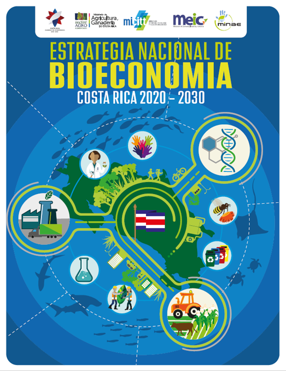
:::
::: {.column width="72%"}
> "La producción, utilización, conservación y regeneración de recursos biológicos, incluyendo los conocimientos, la ciencia, la tecnología y la innovación relacionados con dichos recursos, para proporcionar información, productos, procesos y servicios a todos los sectores económicos, con el propósito de avanzar hacia una economía sostenible."

::: {style="text-align:right"}
[Gobierno de Costa Rica, 2020; German Bioeconomy Council, 2018]{.pequeno}
:::
:::
::::

## Definiciones de bioeconomía

:::: {.columns}
::: {.column width="24%"}
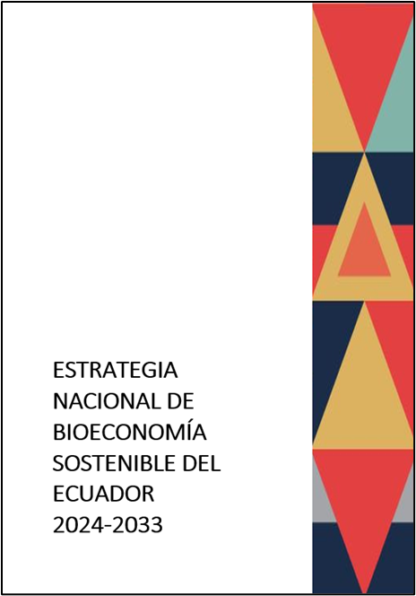
:::
::: {.column width="24%"}

:::
::: {.column width="52%"}
> "La bioeconomía es la producción de bienes y servicios que se basa en el uso sostenible de los recursos biológicos y sus derivados obtenidos a partir de procesos productivos, para promover la creación de empleo y contribuir a la disminución de la pobreza."

::: {style="text-align:right"}
[Libro Blanco de la Bioeconomía Sustentable de Ecuador]{.pequeno}
:::
:::
::::

## ¿Qué debe entenderse por recursos biológicos?

:::: {.columns}
::: {.column width="33%"}
::: resource-col
::: {.recurso .fragment style="--c:#0F7B5F;"}
Biomasa que se cultiva para producir **alimentos, forrajes, fibras y energía**.
:::
::: {.recurso .fragment style="--c:#2F6DB5;"}
Biomasa de los **recursos marinos y acuicultura**.
:::
:::
:::
::: {.column width="33%"}
::: resource-col
::: {.recurso .fragment style="--c:#6B8E23;"}
Biomasa **forestal**.
:::
::: {.recurso .fragment style="--c:#C27C0E;"}
**Biomasa residual** en los sectores agropecuario, pesca y acuacultura, forestal y agroindustrial.
:::
::: {.recurso .fragment style="--c:#8A5A44;"}
Biomasa que se puede recuperar de los **desechos urbanos**.
:::
:::
:::
::: {.column width="33%"}
::: resource-col
::: {.recurso .fragment style="--c:#B3261E;"}
**Desechos líquidos** de la ganadería y de la actividad humana.
:::
::: {.recurso .fragment style="--c:#1E8FA3;"}
**Biodiversidad terrestre y marina**, incluyendo la biodiversidad de aguas continentales.
:::
:::
:::
::::

# Cuentas nacionales y cuentas temáticas {.seccion background-color="#0B4A3A"}

Los cuadros de oferta y utilización son la espina dorsal del sistema.

## Cuentas nacionales y cuentas temáticas

:::: {.columns}
::: {.column width="50%"}
::: {.caja}
**Sistema de Cuentas Nacionales**
:::

::: incremental
- Desempeño económico: producción, consumo y distribución del ingreso.
- El beneficio anual de las actividades económicas.
- Reglas contables, definiciones y clasificaciones estrictas.
:::
:::
::: {.column width="50%"}
::: {.caja .ambar}
**Cuentas temáticas**
:::

::: incremental
- Extienden el alcance del Sistema de Cuentas Nacionales.
- Aíslan un tema en particular para revelar su valor.
- Usan información complementaria pero compatible (física, por ejemplo).
- En algunos casos, modifican definiciones.
:::
:::
::::

## Cuadro de oferta de Argentina, `r A`

```{r}
cuadro_basico(r$basicos$oferta, "oferta")
```

[Miles de millones de pesos corrientes. Fuente: elaboración propia con datos de @indec2023.]{.pequeno}

## Cuadro de utilización de Argentina, `r A`

```{r}
cuadro_basico(r$basicos$utilizacion, "utilizacion")
```

[Miles de millones de pesos corrientes. Fuente: elaboración propia con datos de @indec2023.]{.pequeno}

## Valor agregado y PIB por el método de la producción

```{r}
cuadro_pib(r$basicos)
```

[Miles de millones de pesos corrientes, Argentina, `r A`. Los márgenes y el ajuste CIF/FOB no afectan el total.]{.pequeno}

# Metodología y abordaje {.seccion background-color="#0B4A3A"}

Reordenar las clasificaciones sin tocar los saldos contables.

## Abordaje de cuentas de sectores clave

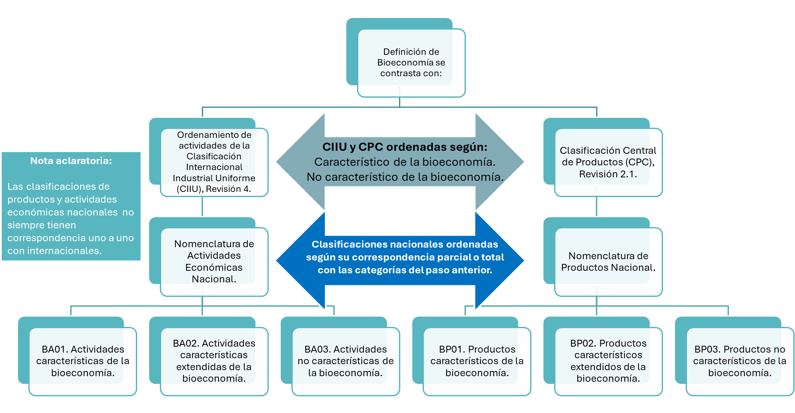{fig-align="center" height="540"}

## Datos ordenados

:::: {.columns}
::: {.column width="28%"}
[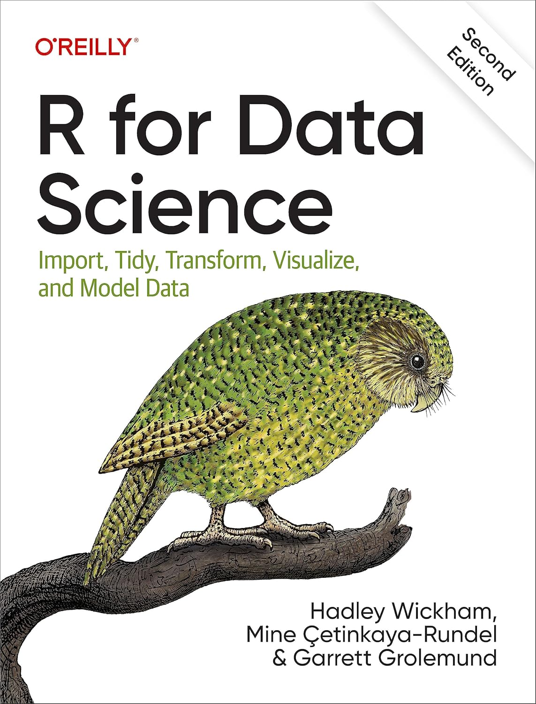](https://es.r4ds.hadley.nz/)
:::
::: {.column width="72%"}
> "Una vez que has importado los datos, es una buena idea **ordenarlos**. [...] **Cuando tus datos están ordenados, cada columna es una variable y cada fila una observación**. Tener datos ordenados es importante porque si su estructura es consistente, puedes enfocar tus esfuerzos en las preguntas sobre los datos."

::: {style="text-align:right"}
[Wickham, Çetinkaya-Rundel y Grolemund, *R para Ciencia de Datos* (2.ª ed.)]{.pequeno}
:::

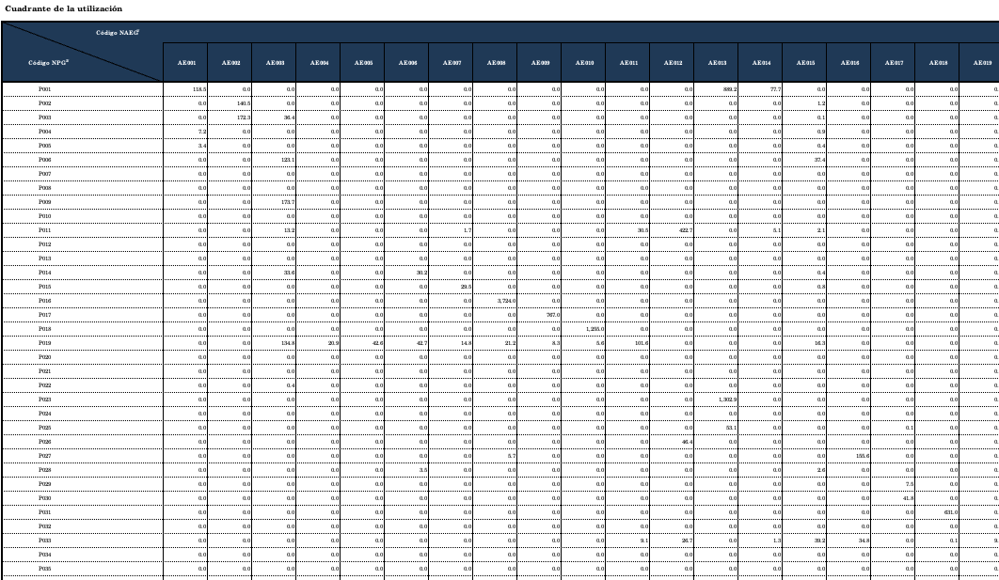{fig-align="center" height="210"}
:::
::::

## Estado inicial

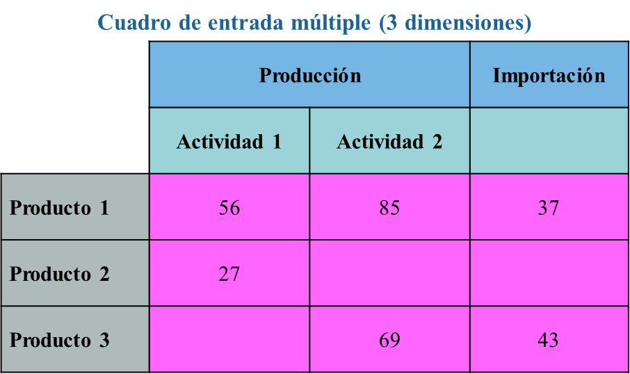{fig-align="center" height="540"}

## Paso 1: del cuadro al archivo plano

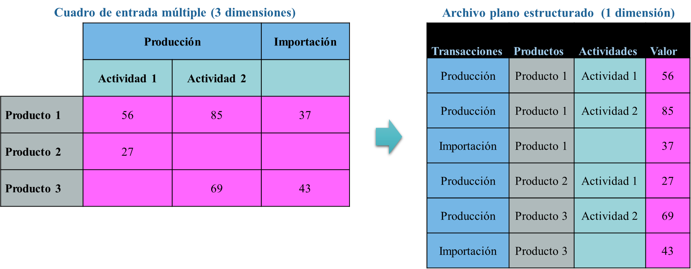{fig-align="center" height="540"}

## Paso 2: agregar la condición bioeconómica

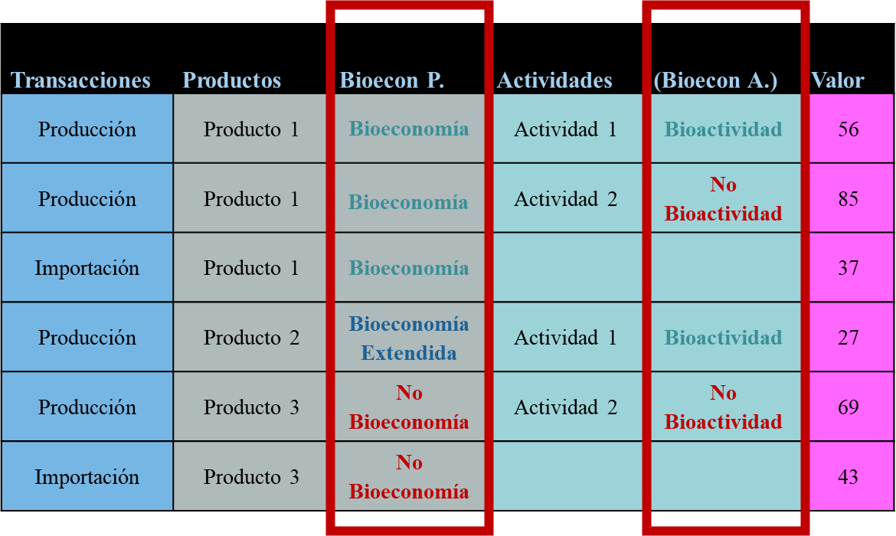{fig-align="center" height="540"}

## Paso 3: volver a un cuadro, ahora con la bioeconomía visible

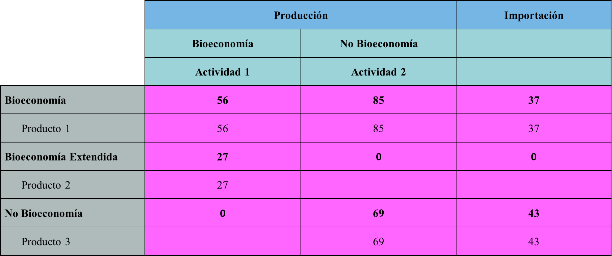{fig-align="center" height="540"}

## Lo que hicimos con el COU de Argentina

::: {.cifras style="--col:3;"}
::: {.cifra}
[`r num(sum(scn$Año == A))`]{.n}
[filas con valor en la base de `r A`: una por cada celda distinta de cero]{.t}
:::
::: {.cifra .ambar}
[3]{.n}
[cuadros en una sola tabla: oferta, utilización y valor agregado]{.t}
:::
::: {.cifra .azul}
[`r periodo`]{.n style="font-size:1.45em;"}
[`r length(anios)` años en una sola base, con la misma rutina y clasificación]{.t}
:::
:::

. . .

```{r}
scn |>
  filter(Año == A, Cuadro == "Oferta", Componente == "Producción", `Bioeconomía Productos` == "Bioeconomía") |>
  arrange(desc(Valor)) |>
  slice(1:5) |>
  transmute(
    Cuadro,
    Producto = str_trunc(str_remove(`Nomenclatura Local de Productos`, "^[^ ]+( [A-Z]+)? - "), 34),
    `Bio. producto` = `Bioeconomía Productos`,
    Actividad = str_trunc(nombre_actividad(`Descripción Actividades`), 34),
    `Bio. actividad` = `Bioeconomía Actividades`,
    Valor = num(Valor)
  ) |>
  tabla_simple("cou mediano", izq = 5)
```

::: {.pequeno}
La rutina comprueba que la oferta sea igual a la utilización para cada producto, que cada fila sume el total de INDEC y reproduce los valores publicados de Argentina para 2018. Valores en millones de pesos. El script y la base están en la sección de descargas.
:::

## ¿Para qué? Cuadros y gráficos a la medida

Una vez ordenada la base, el contenido de insumos de cualquier actividad sale con unos pocos filtros.

```{r}
#| fig-width: 12
#| fig-height: 4.5
g_insumos(scn, A, c(
  "1511" = "Carne",
  "552" = "Restaurantes y bares",
  "242" = "Otros químicos",
  "45" = "Construcción"
), base = 18)
```

[Composición del consumo intermedio de cuatro actividades, Argentina, `r A`.]{.pequeno}

# Resultados {.seccion background-color="#0B4A3A"}

La oferta y la utilización de Argentina, con la lente de la bioeconomía.

## Cuadro de oferta bioeconómica de Argentina, `r A`

```{r}
cuadro_bio_html(r$bio$oferta)
```

[Miles de millones de pesos corrientes. Fuente: elaboración propia con datos de @indec2023.]{.pequeno}

## Cuadro de utilización bioeconómica de Argentina, `r A`

```{r}
cuadro_bio_html(r$bio$utilizacion, va = r$bio$va)
```

[Miles de millones de pesos corrientes. Fuente: elaboración propia con datos de @indec2023.]{.pequeno}

# Cálculo del valor agregado {.seccion background-color="#0B4A3A"}

Dos formas de medir, con resultados distintos.

## Valor agregado por el método de actividades económicas

```{r}
cuadro_va_act(r$va_act)
```

::: {.caja .neutra}
Este es el cálculo tradicional: se decide de antemano qué actividades son bioeconómicas y se suma su valor agregado. Las actividades bioeconómicas aportan **`r pct(md$apriori_bio)`** y las extendidas **`r pct(md$apriori_ext)`**.
:::

## El problema de clasificar de antemano

```{r}
cuadro_bio_html(r$bio$utilizacion, va = r$bio$va, marcar = TRUE)
```

::: {.leyenda}
[<i style="background:#FBE7D3;"></i>**Subestimación:** insumos bioeconómicos que usan actividades no bioeconómicas]{}
[<i style="background:#F8D8D6;"></i>**Sobreestimación:** insumos no bioeconómicos que usan actividades bioeconómicas]{}
:::

## Valor agregado por el método del consumo intermedio

```{r}
cuadro_va_ci(r$va_ci)
```

::: {.caja}
Cada sección aporta valor agregado en proporción a sus insumos bioeconómicos: **`r pct(md$via_ci)` del total**. La condición bioeconómica se vuelve un gradiente [@vargas2023].
:::

## Multiplicadores de uso de insumos bioeconómicos

::: incremental
- Con el cuadro de oferta y utilización se aproxima un modelo de insumo-producto. Con él se estima cuántos insumos bioeconómicos y bioeconómicos extendidos, en pesos, se usan directa e indirectamente por cada peso que una actividad hace llegar a la demanda final.
- Muestra la dependencia directa e indirecta de los productos bioeconómicos.
- Va más allá del sector primario.
- Después se agrupan las actividades según la desviación absoluta mediana (DAM).
:::

. . .

::: {.caja .neutra}
**Alcance.** Es un ejercicio didáctico: usa tecnología de la industria, valores a precios de comprador y uso total, sin separar insumos nacionales de importados. Compara actividades mejor de lo que mide niveles.
:::

## Desviación absoluta mediana (DAM)

Mide qué tan dispersos están los valores en torno a la mediana. No se ve afectada por valores extremos, a diferencia de la desviación estándar.

::: {.cifras style="--col:3;"}
::: {.cifra .fragment}
[+1 DAM]{.n}
[**Sobre la mediana.** Por encima del valor central, pero todavía cerca de él.]{.t}
:::
::: {.cifra .ambar .fragment}
[+2 DAM]{.n}
[**Alta.** Claramente superiores al valor típico.]{.t}
:::
::: {.cifra .azul .fragment}
[+3 DAM]{.n}
[**Muy alta.** Valores atípicos positivos, con un uso muy superior de insumos bioeconómicos.]{.t}
:::
:::

. . .

[En Argentina, `r A`, la mediana es `r num(r$med_dam[["mediana"]], 2)` y la DAM es `r num(r$med_dam[["dam"]], 2)`, en pesos de insumos por peso de demanda final.]{.pequeno}

## Dependencia muy alta de insumos bioeconómicos (1)

```{r}
lista_mult(m, "1. Muy alta", 1, mitad)
```

## Dependencia muy alta de insumos bioeconómicos (2)

```{r}
lista_mult(m, "1. Muy alta", mitad + 1)
```

## Dependencia alta y sobre la mediana

```{r}
lista_mult(m, c("2. Alta", "3. Sobre la mediana"))
```

## Valor agregado por grupo de uso de insumos

```{r}
cuadro_grupos_va(m)
```

::: {.caja}
Las actividades con uso de insumos bioeconómicos superior a la mediana más una DAM generan **`r pct(sum(m$va[m$Grupo != "4. Mediana o abajo"]) / sum(m$va))`** del valor agregado de Argentina.
:::

# Argentina, `r periodo` {.seccion background-color="#0B4A3A"}

La misma medida con `r length(anios)` años de cuadros.

## Participación por condición del producto

```{r}
#| fig-width: 12.4
#| fig-height: 5.7
g_series(r$series, base = 15)
```

[Precios corrientes. Las participaciones también reflejan precios relativos y tipo de cambio.]{.pequeno}

## Tasa impositiva implícita

```{r}
#| fig-width: 12.4
#| fig-height: 5.2
g_tasas(r$tasas, base = 17)
```

[Impuestos menos subvenciones sobre los productos entre valor bruto de producción de los mismos productos.]{.pequeno}

## Valor agregado bioeconómico según el método

```{r}
#| fig-width: 12.4
#| fig-height: 5.2
g_medidas(r$medidas, base = 17, tam = 5)
```

[Porcentaje del valor agregado bruto. Método de actividades: solo actividades bioeconómicas. Método del consumo intermedio: cada sección en proporción a sus insumos bioeconómicos.]{.pequeno}

## Saldo comercial por condición del producto

```{r}
#| fig-width: 12.4
#| fig-height: 5.2
g_saldo(r$comercio, base = 17, tam = 5)
```

[Exportaciones menos importaciones de cada grupo de productos, como porcentaje del PIB a precios corrientes.]{.pequeno}

## Composición de las exportaciones bioeconómicas

```{r}
#| fig-width: 12.4
#| fig-height: 5.4
g_export_comp(r$export_bio, base = 17, tam = 5)
```

[Participación en las exportaciones de productos bioeconómicos, precios corrientes. Los cinco productos son los que más exportan en `r A`.]{.pequeno}

# Resultados en el contexto latinoamericano {.seccion background-color="#0B4A3A"}

Trece países medidos con el mismo método (cifras alrededor de 2018).

## Publicaciones disponibles

Haga clic en las imágenes:

:::: {.columns}
::: {.column width="50%"}
[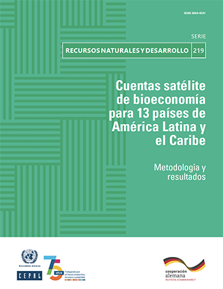{height="470" fig-align="center"}](https://www.cepal.org/es/publicaciones/68683-cuentas-satelite-bioeconomia-13-paises-america-latina-caribe-metodologia)
:::
::: {.column width="50%"}
[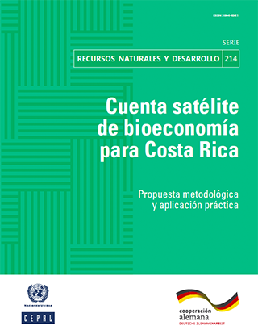{height="470" fig-align="center"}](https://www.cepal.org/es/publicaciones/48641-cuenta-satelite-bioeconomia-costa-rica-propuesta-metodologica-aplicacion)
:::
::::

## Producción (año 2018, porcentajes)

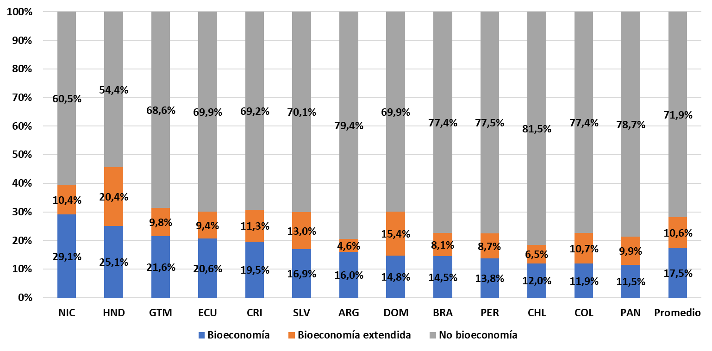{fig-align="center" height="550"}

## Consumo intermedio (año 2018, porcentajes)

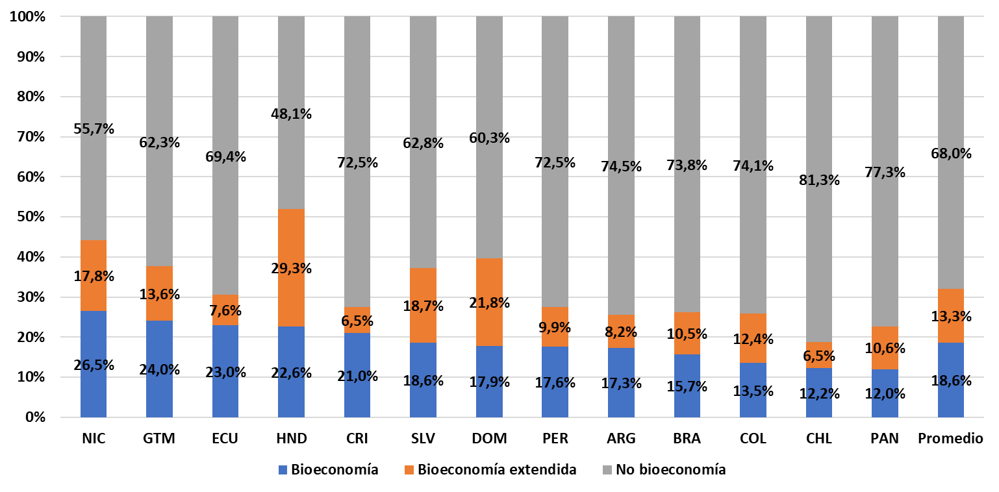{fig-align="center" height="550"}

## Importaciones (año 2018, porcentajes)

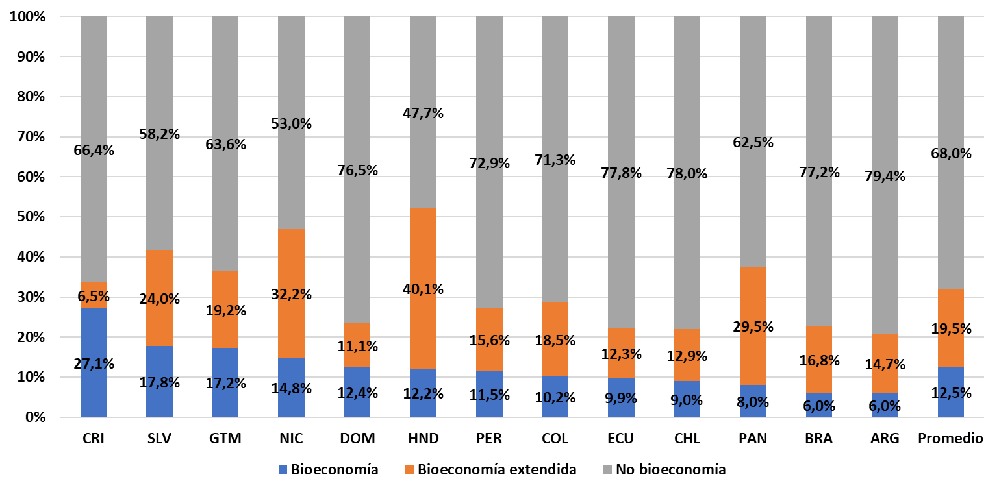{fig-align="center" height="550"}

## Exportaciones (año 2018, porcentajes)

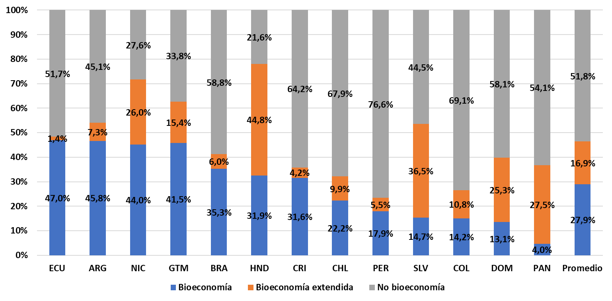{fig-align="center" height="550"}

## Impuestos netos de subvenciones (año 2018, porcentajes)

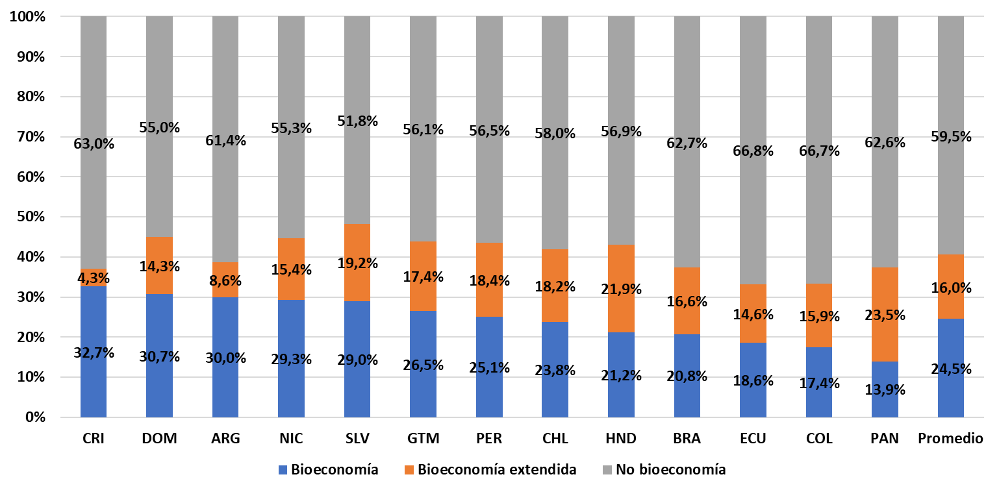{fig-align="center" height="550"}

## Tasa impositiva implícita (año 2018, porcentajes)

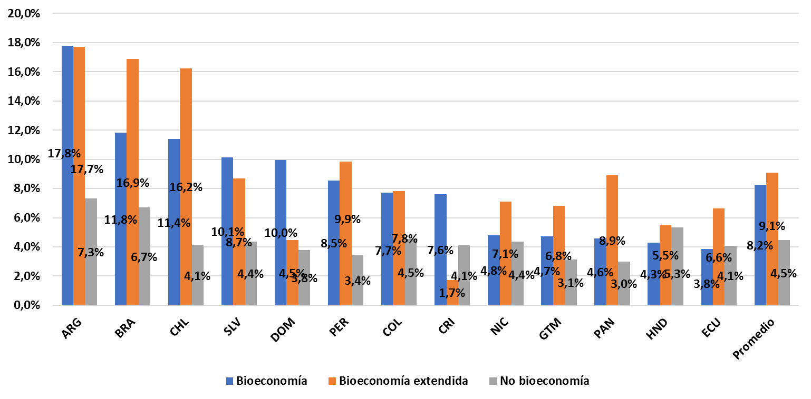{fig-align="center" height="550"}

## Consumo final (año 2018, porcentajes)

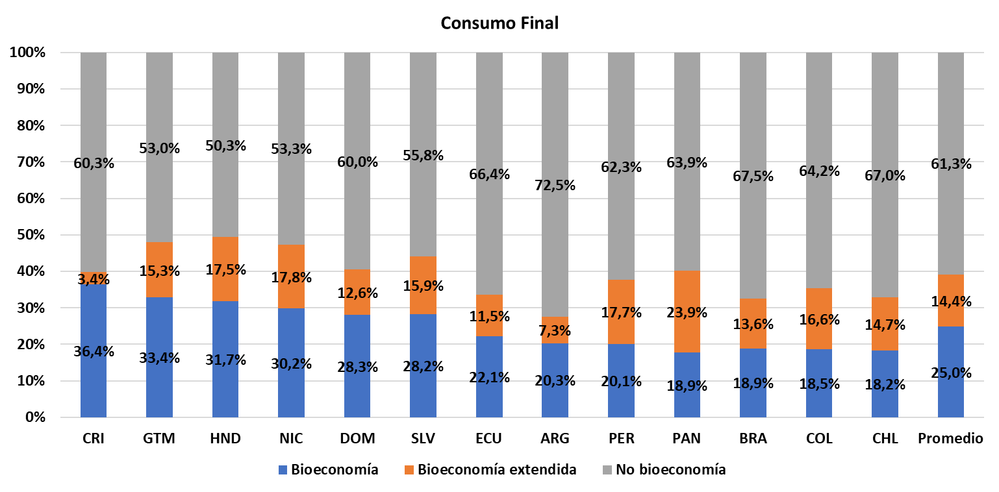{fig-align="center" height="550"}

## Formación bruta de capital (año 2018, porcentajes)

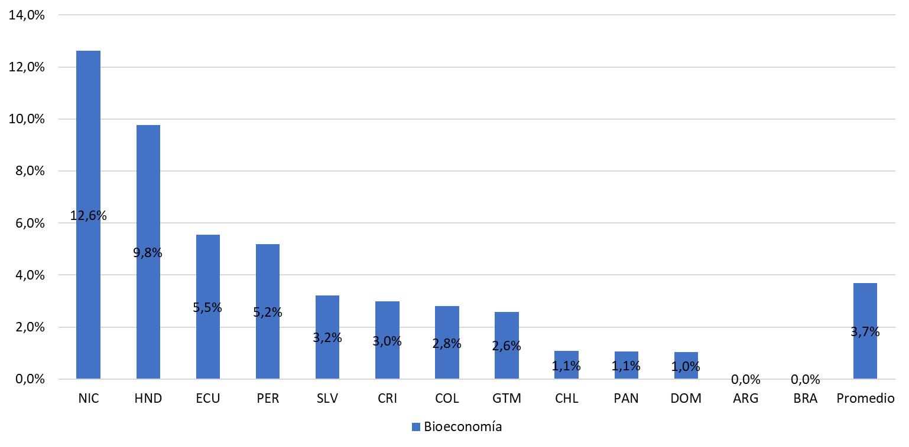{fig-align="center" height="550"}

## Referencias

::: {#refs}
:::

##  {.center background-gradient="linear-gradient(125deg, #0B4A3A 0%, #0F7B5F 65%, #C27C0E 135%)"}

::: {style="text-align:center;color:#fff;"}
[Gracias]{style="font-size:2.4em;font-family:Roboto,sans-serif;font-weight:700;"}

[renatovargas.com](https://renatovargas.com/){style="color:#fff;"}
:::
